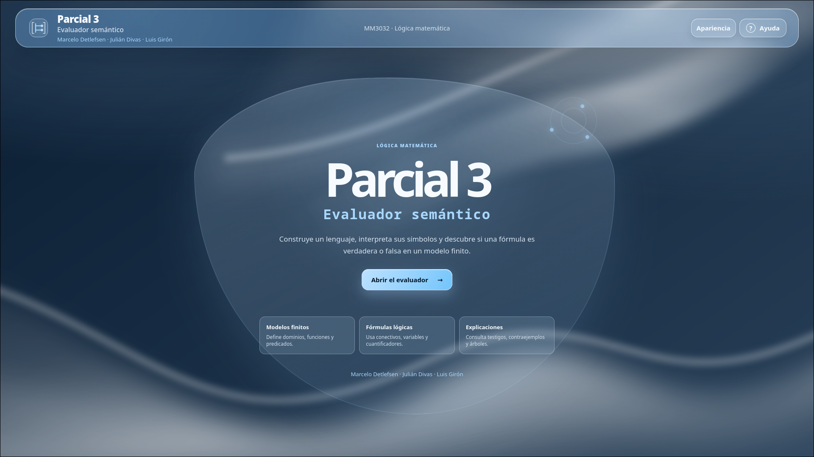
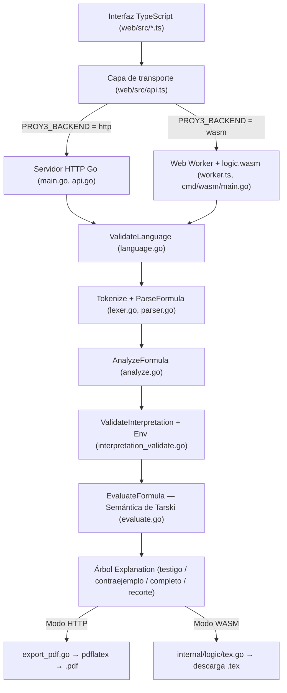
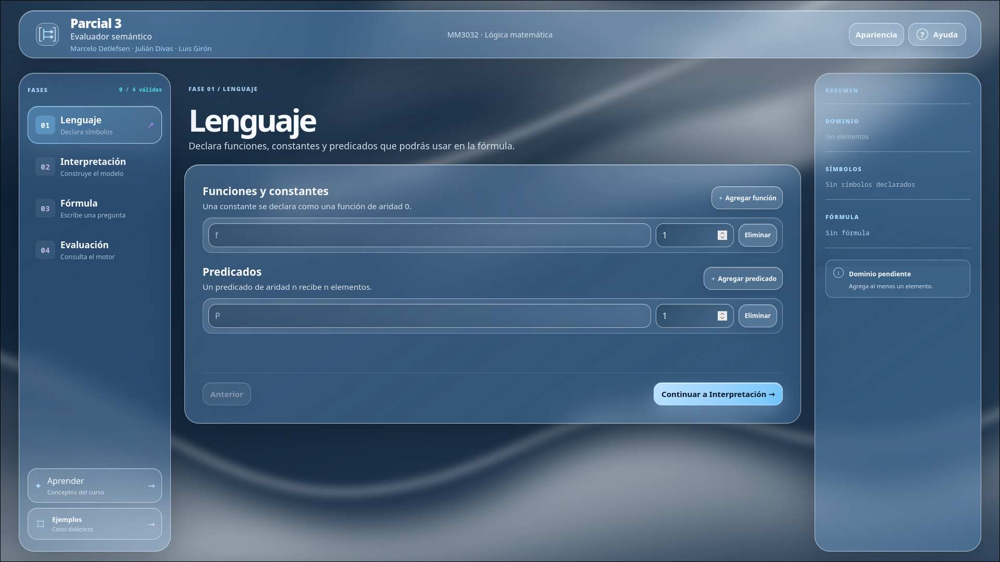
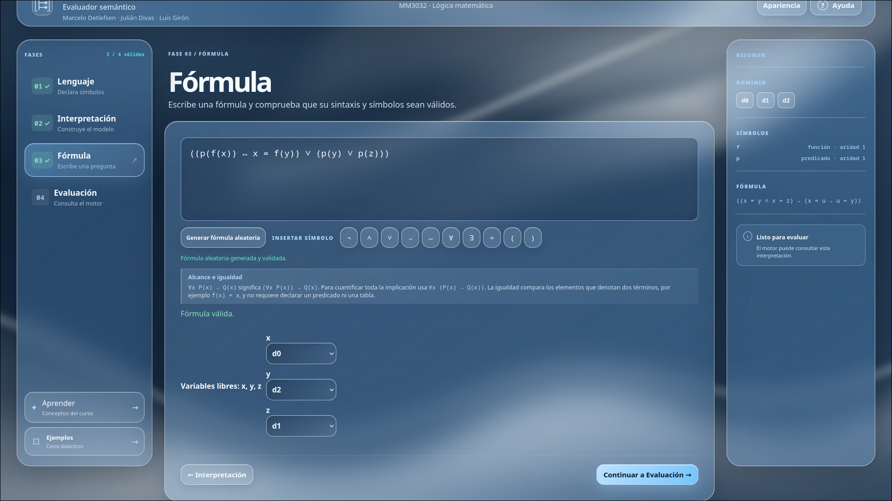
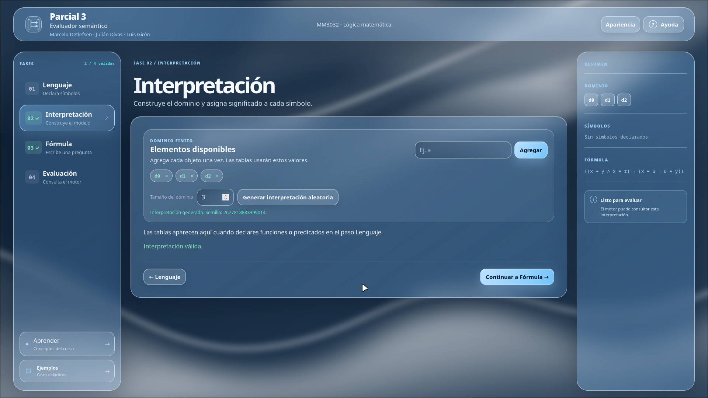
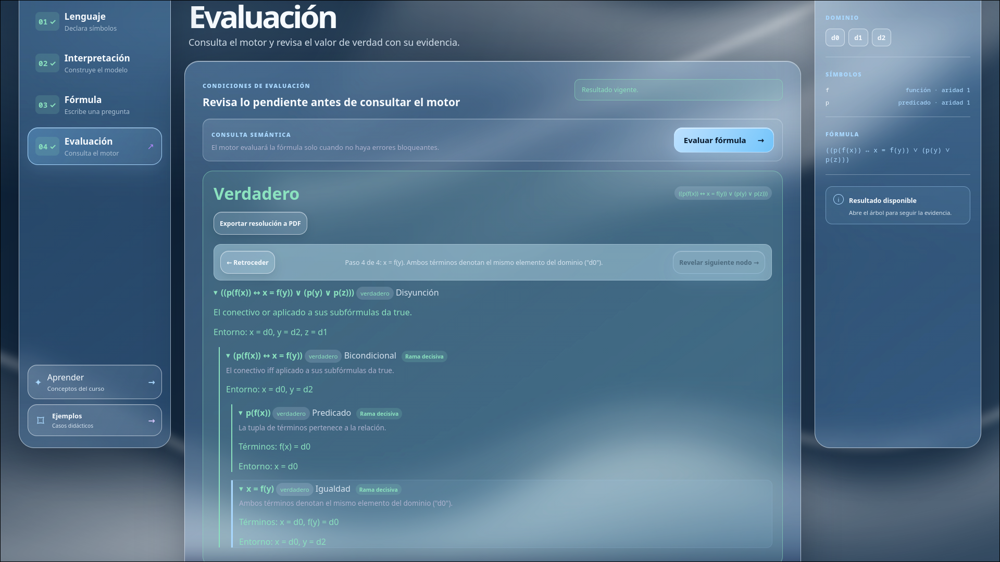

# Parcial 3 -  Evaluador Semántico

[](https://github.com/MarceloDetlefsen/proy3-logica/actions/workflows/ci.yml)
[](https://github.com/MarceloDetlefsen/proy3-logica/actions/workflows/pages.yml)

Aplicación web gráfica para evaluar fórmulas de lógica de primer orden sobre interpretaciones finitas definidas por el usuario. Determina si una fórmula es **Verdadera** o **Falsa** bajo la semántica de Tarski y construye un árbol de explicación interactivo con testigos, contraejemplos, comprobaciones completas y ramas decisivas, además de exportar el procedimiento completo a PDF mediante LaTeX.

- **Demo en línea (GitHub Pages):** <https://marcelodetlefsen.github.io/proy3-logica/> *(ejecuta el núcleo lógico Go compilado a WebAssembly dentro de un Web Worker en el navegador; la exportación descarga el archivo `.tex` y requiere el servidor Docker para compilar el PDF)*.



---

## Requisitos

- **Go:** `1.27` (declarado en [`go.mod`](go.mod); biblioteca estándar, sin dependencias externas).
- **Node.js y TypeScript (`^5.0.0`):** solo necesarios si se modifican archivos `.ts` en `web/src/` (`npm run build:web`) o para ejecutar el smoke test de WebAssembly (`scripts/wasm-smoke.mjs`).
- **LaTeX (`pdflatex`):** solo necesario para exportar la resolución a PDF en ejecución local.
  - **Arch Linux** *(instalación usada por el autor, no verificada en esta sesión)*:
    ```bash
    sudo pacman -S texlive-basic texlive-latex texlive-latexrecommended texlive-fontsrecommended
    ```
  - **Debian / Ubuntu** *(verificada compilando PDF real dentro de Docker)*:
    ```bash
    sudo apt-get install --no-install-recommends texlive-latex-base texlive-latex-recommended texlive-fonts-recommended
    ```
  - **Si falta `pdflatex`:** el evaluador web funciona normalmente; el endpoint `/api/evaluate/export/pdf` responde `503 Service Unavailable` con un mensaje explicativo.
- **Docker o Podman (opcional, recomendado):** incluye Go, Node y TeX Live preconfigurados para que la exportación a PDF funcione sin instalar dependencias en el sistema anfitrión.
- **Navegador:** cualquier navegador moderno con soporte para ES2022, Web Workers y WebAssembly.

Más detalle: [docs/despliegue.md](docs/despliegue.md)

---

## Compilación y ejecución

### 1. Modo local (servidor Go + `pdflatex` opcional)

```bash
npm install
npm run build:web
go run .
```

Abrir <http://localhost:8080>. La dirección de escucha se configura con `ADDR` o `PORT` (por defecto `:8080`). Para compilar un binario nativo:

```bash
go build -trimpath -ldflags "-s -w" -o proy3-logica .
./proy3-logica
```

### 2. Modo Docker / Podman (servidor completo con PDF)

```bash
# Usando Docker Compose (recomendado)
docker compose up --build

# O ejecutando la imagen publicada en GHCR
docker run --rm -p 8080:8080 ghcr.io/marcelodetlefsen/proy3-logica:latest

# O vía Makefile (detecta docker o podman automáticamente)
make docker-build
make docker-run
```

### 3. Modo estático (GitHub Pages / WebAssembly local)

```bash
make pages
python3 -m http.server --directory dist 8081
```

Abrir <http://localhost:8081>.

### Pruebas, benchmarks y verificación de documentación

```bash
go test ./...
go test -run=^$ -bench . -benchmem -count 5 ./...
make docs-check
```

Más detalle: [docs/despliegue.md](docs/despliegue.md) · [docs/rendimiento.md](docs/rendimiento.md)

---

## Controles o uso

### Botones e ingreso por teclado

| Entrada | Acción |
| --- | --- |
| Botones `¬`, `∧`, `∨`, `→`, `↔`, `∀`, `∃`, `=`, `(`, `)` | Inserta el símbolo lógico en la posición actual del cursor |
| `~`, `!` | Aliases ASCII de negación (`¬`) |
| `&`, `/\` | Aliases ASCII de conjunción (`∧`) |
| `\|`, `\/` | Aliases ASCII de disyunción (`∨`) |
| `->`, `=>` | Aliases ASCII de implicación (`→`) |
| `<->`, `<=>` | Aliases ASCII de bicondicional (`↔`) |
| `forall`, `exists` | Aliases ASCII de cuantificadores (`∀`, `∃`, sin distinguir mayúsculas) |
| `Enter` en campo de dominio | Agrega el elemento al dominio finito |

### Flujo de uso en 4 pasos

1. **Lenguaje:** Declara funciones (constantes con aridad `0`, funciones con aridad $\ge 1$) y predicados (aridad $\ge 1$).
2. **Interpretación:** Define el dominio finito no vacío $D$ y completa las tablas de funciones totales y relaciones no vacías (o genera una aleatoria).
3. **Fórmula y entorno:** Escribe la fórmula con teclado o botones y asigna en $D$ cualquier variable libre detectada.
4. **Evaluación:** Consulta el valor de verdad (**Verdadero** / **Falso**), recorre el árbol de explicación paso a paso y exporta a PDF (servidor) o `.tex` (Pages).

### Endpoints HTTP

- `GET /healthz`
- `POST /api/language/validate`
- `POST /api/analyze`
- `POST /api/interpretation/validate`
- `POST /api/interpretation/generate`
- `POST /api/evaluate`
- `POST /api/evaluate/export/pdf`
- `POST /api/models/search`

Más detalle: [docs/api.md](docs/api.md) · [docs/parser.md](docs/parser.md)

---

## Arquitectura o pipeline



Decisiones técnicas clave:

- **Alcance fuerte de cuantificadores:** `∀x P(x) → Q(x)` significa `(∀x P(x)) → Q(x)` para evitar ambigüedades en implicaciones.
- **Precedencia y asociatividad:** `↔` (izq) < `→` (der) < `∨` (izq) < `∧` (izq) < `¬, ∀, ∃` (prefijo).
- **Offsets en runes:** Los errores del lexer/parser indexan caracteres Unicode para seleccionar con precisión en el editor.
- **Errores de validación con HTTP `200`:** Permiten compartir exactamente el mismo contrato JSON entre HTTP y WebAssembly.

Más detalle: [docs/arquitectura.md](docs/arquitectura.md) · [docs/decisiones.md](docs/decisiones.md)

---

## Componentes principales

### Lenguaje y validación


**Evidencia:** `docs/captures/lenguaje.png`

Valida identificadores (`[A-Za-z_][A-Za-z0-9_]*`), nombres reservados (`forall`, `exists`), unicidad entre funciones y predicados, y aridades válidas (`ValidateLanguage` en [`internal/logic/language.go`](internal/logic/language.go), UI en [`web/src/language.ts`](web/src/language.ts)).

| Parámetro o constante | Qué cambia |
| --- | --- |
| Aridad mínima de función (`0`) | Permite declarar constantes como funciones 0-arias |
| Aridad mínima de predicado (`1`) | Exige al menos un argumento por predicado |

### Lexer y parser


**Evidencia:** `docs/captures/formula.png`

Tokeniza Unicode y aliases ASCII con offsets en runes (`Tokenize` en [`internal/logic/lexer.go`](internal/logic/lexer.go)) y construye el AST por descenso recursivo (`ParseFormula` en [`internal/logic/parser.go`](internal/logic/parser.go)), acumulando errores de símbolos y aridades.

| Parámetro o constante | Qué cambia |
| --- | --- |
| `isReservedName` (`forall`, `exists`) | Impide declarar símbolos con nombres de cuantificadores |

Más detalle: [docs/parser.md](docs/parser.md)

### Interpretación finita


**Evidencia:** `docs/captures/interpretacion.png`

Verifica dominio no vacío sin duplicados, completitud de funciones totales en $D^n$, pertenencia al dominio y relaciones no vacías (`ValidateInterpretation` en [`internal/logic/interpretation_validate.go`](internal/logic/interpretation_validate.go), UI en [`web/src/interpretation.ts`](web/src/interpretation.ts)).

| Parámetro o constante | Qué cambia |
| --- | --- |
| `MaxDomainSize = 100` | Tamaño máximo permitido para el dominio $D$ |
| `MaxTableEntries = 10000` | Máximo de filas por tabla de función o relación |
| `MaxIncompleteExamples = 5` | Ejemplos de tuplas faltantes reportados en `FUNC_INCOMPLETE` |

### Evaluador semántico

Evalúa términos y fórmulas recursivamente bajo semántica de Tarski con cortocircuito en conectivos y cuantificadores (`EvaluateFormula`, `evaluationState.eval` y `evalTerm` en [`internal/logic/evaluate.go`](internal/logic/evaluate.go)).

| Parámetro o constante | Qué cambia |
| --- | --- |
| `MaxEvaluationSteps = 100000` | Presupuesto máximo de pasos por petición (`EVAL_LIMIT`) |

Más detalle: [docs/evaluador.md](docs/evaluador.md)

### Árbol de explicación


**Evidencia:** `docs/captures/explicacion.png`

Construye el árbol `Explanation` con testigos (`Witness`), contraejemplos (`Counterexample`), conteo completo (`Checked`/`DomainSize`) y ramas decisivas (`Decisive`), renderizado progresivamente en [`web/src/evaluation.ts`](web/src/evaluation.ts).

| Parámetro o constante | Qué cambia |
| --- | --- |
| `maxExplanationNodes = 2000` | Límite de nodos visuales en el árbol (`Truncated = true`) |

Más detalle: [docs/explicacion.md](docs/explicacion.md)

### Interfaz gráfica

Organizada en 4 fases con temas *Liquid Glass*, lecciones conceptuales, tutorial interactivo y soporte de teclado/accesibilidad ([`web/index.html`](web/index.html), [`web/src/app.ts`](web/src/app.ts)).

Más detalle: [docs/interfaz.md](docs/interfaz.md)

### Exportación a PDF

Genera un documento LaTeX con firma, tablas, entorno, resultado y árbol (`EvaluationTeX` en [`internal/logic/tex.go`](internal/logic/tex.go)) y lo compila con `pdflatex` en [`export_pdf.go`](export_pdf.go).

| Parámetro o constante | Qué cambia |
| --- | --- |
| Timeout de compilación (`30 * time.Second`) | Tiempo máximo de ejecución de `pdflatex` |
| Límite de cuerpo JSON (`2 << 20` = 2 MiB) | Tamaño máximo de petición en `/api/evaluate/export/pdf` |
| Tamaño máximo de PDF (`20 << 20` = 20 MiB) | Tamaño máximo aceptado del PDF generado |

Más detalle: [docs/exportacion-pdf.md](docs/exportacion-pdf.md)

### Aleatorización

Genera interpretaciones reproducibles por semilla (`GenerateRandomInterpretation` en [`internal/logic/interpretation_generate.go`](internal/logic/interpretation_generate.go)) y fórmulas aleatorias bien formadas (`buildRandomFormula` en [`web/src/formula.ts`](web/src/formula.ts)).

| Parámetro o constante | Qué cambia |
| --- | --- |
| `MaxGeneratedArity = 1000` | Aridad máxima generable automáticamente |
| `maxGeneratedRelationTuples = 1000` | Límite de tuplas muestreadas cuando $\|D\|^n > 10\,000$ |

Más detalle: [docs/aleatorizacion.md](docs/aleatorizacion.md)

### Despliegue con Docker y GitHub Pages

Contenedor multi-stage endurecido con TeX Live ([`Dockerfile`](Dockerfile), [`docker-compose.yml`](docker-compose.yml)) y compilación estática a WebAssembly en Web Worker ([`cmd/wasm/main.go`](cmd/wasm/main.go), [`web/src/worker.ts`](web/src/worker.ts), [`web/src/api.ts`](web/src/api.ts)).

| Parámetro o constante | Qué cambia |
| --- | --- |
| `DEFAULT_WASM_TIMEOUT_MS = 10000` | Tiempo límite del Web Worker antes de reiniciarlo |
| `PORT` / `ADDR` (`:8080`) | Puerto/dirección de escucha del servidor HTTP |

Más detalle: [docs/despliegue.md](docs/despliegue.md)

### Búsqueda de modelos y contramodelos

Enumera interpretaciones finitas con dominios de tamaño `1` hasta `N` (`1 <= N <= 100`) y entornos de variables libres para hallar un modelo que satisfaga la fórmula y un contramodelo que la refuta (`SearchModels` en [`internal/logic/model_search.go`](internal/logic/model_search.go), UI en [`web/src/evaluation.ts`](web/src/evaluation.ts), disponible tanto en servidor HTTP como en WebAssembly).

| Parámetro o constante | Qué cambia |
| --- | --- |
| `MaxSearchedInterpretations = 2000` | Máximo de interpretaciones candidatas enumeradas |
| `MaxSearchedEvaluations = 5000` | Máximo de evaluaciones (modelo + entorno) por búsqueda |
| `maxSearchTableEntries = 128` | Tamaño máximo de tabla permitido durante la enumeración |

### Aportes creativos adicionales

Incluye igualdad lógica integrada (`=`), modo educativo de 6 lecciones, tutorial de 6 pasos, 5 temas visuales y modo `?mock=1`.

Más detalle: [docs/creativos.md](docs/creativos.md)

---

## Funcionalidades o criterios evaluables

| Funcionalidad o criterio | Puntos | Cumple | Componente | Archivo y función | Parámetro modificable |
| --- | --- | --- | --- | --- | --- |
| Evaluación semántica y justificación | 30 | ✅ | Evaluador y explicación | `internal/logic/evaluate.go` (`EvaluateFormula`, `eval`) | `MaxEvaluationSteps`, `maxExplanationNodes` |
| Análisis sintáctico | 10 | ✅ | Lexer, parser y análisis | `internal/logic/parser.go` (`ParseFormula`), `analyze.go` | `isReservedName` |
| Interfaz gráfica | 10 | ✅ | UI 4 fases y controles | `web/src/app.ts`, `formula.ts`, `evaluation.ts` | `DEFAULT_WASM_TIMEOUT_MS` |
| Defensa individual | 30 | — | Calificada por el docente | Guía en [`docs/defensa.md`](docs/defensa.md) | — |
| Aportes creativos (creatividad 5, valor 6, calidad 6, defensa 3) | 20 | — | Calificados por el docente | Inventario en [`docs/creativos.md`](docs/creativos.md) | — |

---

## Verificación de reglas

| Regla solicitada | Estado | Verificación en el proyecto |
| --- | --- | --- |
| 1. Lenguaje configurable (funciones y predicados con aridad) | ✅ Cumple | `ValidateLanguage` (`internal/logic/language.go`), `TestValidateLanguage`, UI en `web/src/language.ts` |
| 2. Interpretación finita no vacía, funciones totales y relaciones no vacías | ✅ Cumple | `ValidateInterpretation` (`internal/logic/interpretation_validate.go`), `TestValidateInterpretation*` |
| 3. Sintaxis con todos los conectivos lógicos | ✅ Cumple | `Tokenize` (`internal/logic/lexer.go`), `ParseFormula` (`internal/logic/parser.go`), `TestParseFormulaPrecedence` |
| 4. Variables libres, fórmulas abiertas/cerradas y entorno en $D$ | ✅ Cumple | `AnalyzeFormula` (`internal/logic/analyze.go`), `EvaluateFormula` (`internal/logic/evaluate.go`), `TestAnalyzeFormulaIntegration` |
| 5. Interfaz gráfica con botones de símbolos y edición por teclado | ✅ Cumple | `web/index.html`, `insertAtCursor` en `web/src/formula.ts`, [`docs/ui-checklist.md`](docs/ui-checklist.md) |
| 6. Resultado Verdadero/Falso y explicación decisiva (testigo, contraejemplo, completa) | ✅ Cumple | `evaluationState.eval` (`internal/logic/evaluate.go`), `TestEvaluateSharedExamples` sobre 18 fixtures |
| 7. Detección de errores sin emitir valor de verdad | ✅ Cumple | `EvaluateFormula` retorna `Result: nil` si `len(Errors) > 0`; `TestInterpretationAndEvaluationErrorCodes` |

## Estructura del proyecto

```text
.
├── .dockerignore                         # Exclusiones del contexto de compilación Docker
├── .github/
│   └── workflows/
│       ├── ci.yml                        # Pruebas Go/WASM, docs-check y smoke test Docker
│       ├── docker.yml                    # Publicación de imagen en GHCR (main y tags v*)
│       └── pages.yml                     # Despliegue estático en GitHub Pages
├── Dockerfile                            # Build multi-stage (Node + Go estático + TeX Live)
├── Makefile                              # Atajos: run, test, bench, pages, verify-pages, docker-*, docs-check
├── README.md                             # Documentación principal del proyecto
├── api.go                                # Handlers HTTP de /api/*
├── api_test.go                           # Pruebas de integración HTTP y /healthz
├── cmd/
│   └── wasm/
│       └── main.go                       # Punto de entrada WebAssembly (//go:build js && wasm)
├── docker-compose.yml                    # Servicio endurecido (read_only, tmpfs, cap_drop)
├── docs/
│   ├── README.md                         # Índice de estudio y orden de lectura
│   ├── arquitectura.md                   # Pipeline, paquetes y contrato Go/TypeScript
│   ├── contrato-evaluador.md             # Especificación JSON compartida entre Go y TS
│   ├── creativos.md                      # Aportes creativos y rúbrica
│   ├── defensa.md                        # Banco de preguntas por módulo y guion de 3 min
│   ├── despliegue.md                     # Modos local, Docker y GitHub Pages (WASM)
│   ├── evaluador.md                      # Semántica de Tarski, errores y ejemplos a mano
│   ├── explicacion.md                    # Construcción de testigos, contraejemplos y recorte
│   ├── exportacion-pdf.md                # Plantilla LaTeX, paquetes TeX y endurecimiento
│   ├── parser.md                         # Gramática, precedencia, aliases y offsets en runes
│   ├── rendimiento.md                    # Benchmarks con testing.B y límites observados
│   └── captures/                         # Capturas reales de la interfaz enlazadas en el README
├── docs_test.go                          # Verificación automática de enlaces y rutas en docs
├── export_pdf.go                         # Invocación segura de pdflatex con timeout y -no-shell-escape
├── export_pdf_bench_test.go              # Benchmark de generación .tex
├── go.mod                                # Módulo Go 1.27 (cero dependencias externas)
├── internal/
│   └── logic/
│       ├── analyze.go                    # Análisis de fórmula y cálculo de variables libres
│       ├── api_pipeline.go               # Lógica compartida entre HTTP y WASM
│       ├── ast.go                        # Nodos Term y Formula y serialización JSON
│       ├── errors.go                     # Códigos y estructura LogicError
│       ├── evaluate.go                   # Evaluador de Tarski, presupuesto y árbol Explanation
│       ├── evaluator_contract.go         # Contrato JSON y límites (MaxDomainSize, MaxTableEntries)
│       ├── interpretation_generate.go    # Generación aleatoria reproducible por semilla
│       ├── interpretation_validate.go    # Validación de dominio, funciones totales y relaciones
│       ├── language.go                   # Validación de nombres, aridades y palabras reservadas
│       ├── lexer.go                      # Tokenizador Unicode/ASCII con offsets en runes
│       ├── logic_bench_test.go           # Benchmarks de parser, evaluador, explicación y generación
│       ├── model_search.go               # Búsqueda acotada de modelos y contramodelos finitos
│       ├── model_search_test.go          # Pruebas unitarias de SearchModels
│       ├── parser.go                     # Parser por descenso recursivo con alcance fuerte
│       └── tex.go                        # Generación pura en Go del documento LaTeX (.tex)
├── main.go                               # Servidor HTTP embebido, /healthz y flag -healthcheck
├── package.json                          # Script build:web (tsc -p web/tsconfig.json)
├── scripts/
│   ├── build-pages.sh                    # Genera dist/ (TS + logic.wasm + wasm_exec.js + config.js)
│   ├── check-pages.sh                    # Verifica rutas relativas y archivos obligatorios en dist/
│   ├── docker-smoke.sh                   # Levanta el contenedor y valida /healthz, evaluación y %PDF
│   ├── verify-pages.sh                   # Verificación unificada de WASM para ci.yml y pages.yml
│   └── wasm-smoke.mjs                    # Prueba logic.wasm en Node con fixtures de testdata/
├── testdata/
│   └── examples/                         # 18 fixtures JSON válidos e inválidos (ej. universal-verdadero.json)
├── types.go                              # Tipos heredados sin uso activo (código muerto)
└── web/
    ├── index.html                        # Estructura de las 4 fases, ejemplos, lecciones y tutorial
    ├── app.css                           # Estilos de componentes y disposición
    ├── theme.css                         # Sistema visual Liquid Glass y 5 temas
    ├── config.js                         # Selección de backend ("http" por defecto; "wasm" en Pages)
    ├── types.ts                          # Tipos TypeScript espejados de internal/logic
    ├── tsconfig.json                     # Configuración de TypeScript (ES2022)
    └── src/
        ├── api.ts                        # Transporte común HttpTransport / WasmTransport
        ├── app.ts                        # Navegación de fases, ejemplos, temas y tutorial
        ├── evaluation.ts                 # Evaluación, árbol paso a paso y exportación PDF/.tex
        ├── formula.ts                    # Editor, inserción de símbolos, entorno y fórmula aleatoria
        ├── interpretation.ts             # Dominio en chips, tablas y modelo aleatorio
        ├── language.ts                   # Alta/baja de funciones y predicados
        ├── state.ts                      # Estado global, debounce y modo ?mock=1
        └── worker.ts                     # Web Worker que carga wasm_exec.js y logic.wasm
```

---

## Limitaciones conocidas

- **Costo exponencial de cuantificadores anidados:** Evaluar $k$ cuantificadores sobre $D$ cuesta $O(|D|^k)$ en el peor caso, acotado por `MaxEvaluationSteps = 100000`.
- **Límites de tablas y dominio:** `MaxDomainSize = 100` y `MaxTableEntries = 10000` (y `maxExplanationNodes = 2000` nodos visuales).
- **PDF solo en servidor o Docker:** GitHub Pages es estático y descarga el `.tex` en lugar de compilar el PDF.
- **Timeout en navegador:** El Web Worker aborta operaciones WASM que superen 10 s.
- **Doble subíndice en LaTeX:** Identificadores válidos con más de un guion bajo no inicial (ej. `x_1_2`) provocan error `Double subscript` al compilar con `pdflatex`.

---

## Dependencias principales

- [Biblioteca estándar de Go](https://pkg.go.dev/std) — Servidor HTTP, `embed`, JSON, `crypto/rand`, `syscall/js` (cero módulos externos en `go.mod`).
- [TypeScript (`^5.0.0`)](https://www.typescriptlang.org/) — Compilación del frontend vanilla (`web/src/` → `web/build/`).
- [TeX Live (`pdflatex`)](https://www.tug.org/texlive/) — Compilación de reportes LaTeX a PDF en servidor/Docker.
- [Docker](https://www.docker.com/) — Empaquetado reproducible con LaTeX incluido y endurecido.
- [GitHub Actions](https://github.com/features/actions) — `actions/checkout`, `actions/setup-go`, `actions/setup-node`, `docker/*`, `actions/*-pages*`.

---

## Autores

**Marcelo Detlefsen** - 24554<br>
**Julían Divas** - 24687<br>
**Luis Angel Girón** - 24753<br>
*Universidad del Valle de Guatemala*<br>
*Lógica Matemática - Parcial 3*
